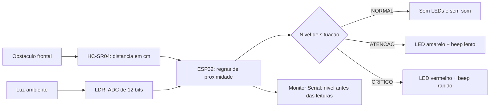

# FreePass — Alerta local de obstáculos para pessoas com baixa visão

**FIAP · Global Solution 2026.2 · AICSS · Prova substitutiva · CitizenTech**

> Protótipo didático simulado: não é equipamento assistivo certificado, não identifica desníveis/buracos e **não substitui bengala, orientação ou acompanhamento especializado**.

## 1. Problema, público e proposta

Pessoas com baixa visão podem enfrentar dificuldade adicional para identificar obstáculos durante deslocamentos, especialmente em ambientes com pouca luz. O **FreePass** é um protótipo de percepção complementar, pensado para apontar obstáculos **à frente do sensor** e avisar imediatamente o usuário por **buzzer** e LEDs. Não identifica obstáculos fora do cone de detecção.

O **HC-SR04** mede distância frontal em centímetros. O **LDR** mede a luminosidade por sinal analógico: quando o ambiente está mais escuro, a distância em que o sistema começa a alertar é ampliada. A decisão ocorre inteiramente no ESP32, sem internet, GPS, nuvem nem IA embarcada.

Como evidência de relevância social, a OMS informa que pelo menos 2,2 bilhões de pessoas no mundo apresentam deficiência visual para perto ou longe. Isso **não é uma estimativa de público diretamente beneficiado pelo protótipo**, mas contextualiza a necessidade de tecnologias acessíveis de apoio à percepção. Fonte: https://www.who.int/news-room/fact-sheets/detail/blindness-and-visual-impairment/

**ODS 11 — Cidades e comunidades sustentáveis**: a meta 11.2 prevê atenção às necessidades de mobilidade das pessoas com deficiência. O FreePass relaciona-se à temática de acessibilidade, sem reivindicar eficácia clínica ou certificação. Fonte: https://brasil.un.org/pt-br/sdgs/11

## 2. Fluxo funcional



## 3. Componentes e função

| Componente                                      | Função                                                |
| ----------------------------------------------- | ----------------------------------------------------- |
| ESP32 DevKit C V4                               | Aquisição, classificação e atuação local              |
| HC-SR04                                         | Sensor 1: distância até um objeto à frente (cm)       |
| Fotoresistor LDR (`wokwi-photoresistor-sensor`) | Sensor 2: nível relativo de luminosidade (ADC 0–4095) |
| Buzzer piezoelétrico                            | Alerta sonoro ao cidadão                              |
| LED amarelo e LED vermelho                      | Visualização auxiliar dos níveis de atenção e crítico |
| 2 resistores de 220 Ω                           | Limitação de corrente dos LEDs                        |

Ambos os sensores alimentam a lógica: o HC-SR04 determina a proximidade, e o LDR altera o limiar de ATENÇÃO. Não se trata de entradas cosméticas ou variáveis fictícias.

## 4. Regras de decisão

O valor `luminosidade_adc >= 2048` é interpretado como **BAIXA_LUZ** no protótipo. É um limiar didático de ADC do módulo LDR padrão do Wokwi, **não uma medição calibrada em lux**. Quanto menor a luz, maior tende a ser a leitura analógica do circuito simulado.

| Distância frontal                              | Ambiente iluminado (ADC < 2048) | Ambiente com baixa luz (ADC >= 2048) |
| ---------------------------------------------- | ------------------------------- | ------------------------------------ |
| Leitura inválida (timeout ou fora de 2–400 cm) | ATENÇÃO                         | ATENÇÃO                              |
| Até 40 cm, inclusive                           | CRÍTICO                         | CRÍTICO                              |
| Mais de 40 até 100 cm, inclusive               | ATENÇÃO                         | ATENÇÃO                              |
| Mais de 100 até 150 cm, inclusive              | NORMAL                          | ATENÇÃO                              |
| Mais de 150 cm                                 | NORMAL                          | NORMAL                               |

O intervalo de alerta aumenta com pouca iluminação, mas pouca luz **sem objeto próximo não dispara alerta contínuo**.

Sinalização:

- **NORMAL**: LEDs apagados, buzzer silencioso.
- **ATENÇÃO**: LED amarelo aceso; buzzer de 1000 Hz durante 120 ms em cada ciclo de 900 ms.
- **CRÍTICO**: LED vermelho aceso; buzzer de 2200 Hz durante 160 ms em cada ciclo de 300 ms.

Em caso de falta de leitura válida do ultrassônico, o nível é ATENÇÃO por precaução; o firmware não interpreta uma falha de sensor como caminho livre. Esses parâmetros são experimentais e não representam distâncias de segurança homologadas.

## 5. Intervalos e motivo

| Operação                         |                          Intervalo | Justificativa                                                                                                        |
| -------------------------------- | ---------------------------------: | -------------------------------------------------------------------------------------------------------------------- |
| Leitura simultânea HC-SR04 + LDR |                             250 ms | Reavaliação 4 vezes por segundo para uma demonstração de deslocamento lento, respeitando o tempo do eco ultrassônico |
| Timeout do eco                   |                  28.000 µs (28 ms) | Impede espera indefinida quando o HC-SR04 não retorna eco                                                            |
| Relatório periódico Serial       |                           1.000 ms | Mantém dados legíveis sem enviar mensagens em todo ciclo                                                             |
| Mudança de nível                 |             No ciclo que a detecta | Atualiza atuador e imprime imediatamente a nova classificação                                                        |
| Padrão sonoro                    | Avaliado continuamente no `loop()` | Evita usar `delay()` para controlar os beeps                                                                         |

A leitura com `pulseIn` pode bloquear **até 28 ms**, mas o controle de periodicidade e das sinalizações usa diferenças de `millis()`, sem `delay()` no laço principal. Não se trata de processamento de tempo real rígido.

## 6. Ligações do circuito

| Origem              | Destino                                             |
| ------------------- | --------------------------------------------------- |
| ESP32 `5V`          | HC-SR04 `VCC`                                       |
| ESP32 `GND.1`       | HC-SR04 `GND`                                       |
| ESP32 `GPIO26`      | HC-SR04 `TRIG`                                      |
| ESP32 `GPIO27`      | HC-SR04 `ECHO` (apenas simulação; ver aviso abaixo) |
| ESP32 `3V3`         | LDR `VCC`                                           |
| ESP32 `GND.2`       | LDR `GND`                                           |
| ESP32 `GPIO34`      | LDR `AO`                                            |
| ESP32 `GPIO18`      | Ânodo LED amarelo                                   |
| Cátodo LED amarelo  | Resistor 220 Ω → GND                                |
| ESP32 `GPIO19`      | Ânodo LED vermelho                                  |
| Cátodo LED vermelho | Resistor 220 Ω → GND                                |
| ESP32 `GPIO25`      | Buzzer positivo (`2`)                               |
| ESP32 `GND.3`       | Buzzer negativo (`1`)                               |

**Importante para montagem física:** o `ECHO` de módulos HC-SR04 alimentados em 5 V pode ter sinal de 5 V, acima do tolerado pelos GPIOs do ESP32 (3,3 V). É necessário divisor resistivo ou conversor de nível lógico nesse fio. O `diagram.json` representa a simulação Wokwi, onde a ligação direta é utilizada. Não copiar essa ligação diretamente para hardware físico.

O circuito editável está em [`diagram.json`](diagram.json). A estrutura lógica está em [`docs/arquitetura.md`](docs/arquitetura.md).

## 7. Estrutura do repositório

```text
/
├── src/
│   └── main.ino               # Inicializacao, leitura, atuacao e Serial
├── include/
│   └── AlertPolicy.h          # Modelo e regras, independentes do Arduino
├── docs/
│   ├── arquitetura.md
│   └── analise-requisitos.md
├── platformio.ini
├── diagram.json
├── wokwi.toml
└── README.md
```

## 8. Como compilar e executar no Wokwi

**Pré-requisitos:** VS Code + extensões PlatformIO e Wokwi; no computador, PlatformIO com acesso à plataforma ESP32. A compilação requer o SDK/framework Arduino para ESP32 disponível ou instalado pelo PlatformIO. O projeto não usa bibliotecas de terceiros.

1. Abra esta pasta no VS Code.
2. Compile pelo comando `pio run` ou botão **Build** do PlatformIO.
3. Abra `diagram.json` com a extensão Wokwi (com a configuração de firmware descrita no `wokwi.toml`).
4. Inicie a simulação e abra o Serial Monitor em **115200 baud**.
5. Clique no **HC-SR04** e mude a distância usando o controle do simulador.
6. Clique no **LDR** e mude o atributo `lux` para simular ambientes claros e escuros.
7. Observe LEDs, buzzer e relatórios Serial (nível sempre primeiro, seguido das leituras).

**Valores de demonstração sugeridos**: a distância inicial no `diagram.json` é **200 cm** e o LDR está em **400 lux**. Troque para 80 cm / 400 lux, depois 120 cm / 20 lux, depois 35 cm / 400 lux para observar os três níveis. O valor exato do ADC é produzido pelo simulador e não deve ser inventado no relatório.

**Observação:** Wokwi e PlatformIO não foram executados neste ambiente de geração; a compatibilidade final precisa ser confirmada com esses passos, pelo responsável da entrega. Os testes host executados estão documentados e **não substituem** evidências do Wokwi.

## 9. Limitações

- **Não é** bengala eletrônica certificada, medidor de risco de queda, navegação autônoma ou dispositivo médico.
- Ultrassom não detecta tudo: depende de ângulo, material, posição do sensor e superfície; não detecta com segurança degraus ou buracos.
- O LDR mede apenas luminosidade relativa local, com limiar de ADC arbitrado para o simulador; não representa lux calibrados.
- Distâncias de 40/100/150 cm são configurações didáticas, não validadas com pessoas ou em trânsito real.
- Buzzer pode não ser audível para todas as pessoas e pode ser inadequado em ambientes barulhentos.
- Não há bateria, gabinete, ensaios físicos ou provas de ergonomia.
- Testes em máquina host foram executados, mas não houve compilação real por PlatformIO, execução Wokwi nem ensaios com ESP32 físico nesta geração.

## 10. Referências técnicas e acadêmicas

- Enunciado fornecido: _GS sub - 2026.2 - AICSS - AGO-1TIAPR-2026.pdf_ (atividade individual, 2 sensores, 1 atuador, 3 níveis, Serial e evidências).
- FIAP CitizenTech: https://experience.fiap.com.br/global-solution-citizen-tech
- Wokwi — HC-SR04: https://docs.wokwi.com/parts/wokwi-hc-sr04
- Wokwi — LDR: https://docs.wokwi.com/parts/wokwi-photoresistor-sensor
- Wokwi — Buzzer: https://docs.wokwi.com/parts/wokwi-buzzer
- OMS — Deficiência visual: https://www.who.int/news-room/fact-sheets/detail/blindness-and-visual-impairment/
- ONU Brasil — ODS 11: https://brasil.un.org/pt-br/sdgs/11
