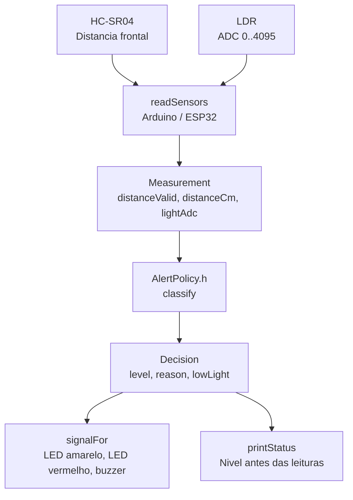

# Arquitetura e responsabilidades

## Modelo

## Separação de responsabilidades

- `src/main.ino`: define GPIOs, intervalos, inicializa hardware, faz medições, gerencia agendamento e envia saídas físicas/Serial. Não contém as regras de classificação.
- `include/AlertPolicy.h`: define `Measurement`, `Decision`, enum dos três níveis, limites de decisão e padrão de buzzer. Não depende de Arduino, Wokwi ou plataformas de rede.

## Fluxo por ciclo

1. O ESP32 inicia os GPIOs e faz a primeira leitura.
2. A cada 250 ms, envia pulso de 10 µs no `TRIG`, aguarda `ECHO` por até 28 ms, converte `tempo/58` para centímetros e lê o LDR no GPIO34 por ADC de 12 bits.
3. A política classifica NORMAL, ATENÇÃO ou CRÍTICO. Falhas de distância entram em ATENÇÃO.
4. A saída sonora e visual acompanha o nível. Os pulsos de áudio são temporizados por `millis()`, sem `delay()`.
5. O Serial informa imediatamente quando o nível muda e, no restante, a cada 1 s. Sempre começa por `nivel_situacao`, seguido dos valores de ambos os sensores.

## Valores configuráveis

| Arquivo | Constante | Valor |
|---|---|---|
| `AlertPolicy.h` | `LOW_LIGHT_ADC` | 2048 |
| `AlertPolicy.h` | `CRITICAL_DISTANCE_CM` | 40 cm |
| `AlertPolicy.h` | `ATTENTION_DISTANCE_BRIGHT_CM` | 100 cm |
| `AlertPolicy.h` | `ATTENTION_DISTANCE_DARK_CM` | 150 cm |
| `src/main.ino` | `READ_INTERVAL_MS` | 250 ms |
| `src/main.ino` | `SERIAL_INTERVAL_MS` | 1000 ms |
| `src/main.ino` | `ECHO_TIMEOUT_US` | 28000 µs |

## Origem de dados

- **Distância**: eco produzido pelo `wokwi-hc-sr04`, alterado no controle de distância durante a simulação; em um dispositivo físico, o HC-SR04 dependeria de propagação e reflexão ultrassônica.
- **Luminosidade**: tensão analógica gerada pelo módulo LDR simulado, que varia conforme `lux` configurado. O ADC de 12 bits reflete uma grandeza relativa, **não lux medidos/calibrados**.
- **Tempo**: `millis()` desde a inicialização da placa; não representa data/hora UTC.
- **Nível**: calculado localmente por regras explícitas; não vem de API, modelo preditivo ou IA.

## Conexões

O diagrama de ligação editável está no `diagram.json` na raiz. O mapeamento completo e o aviso de nivelamento de 5 V no `ECHO` estão no README.
